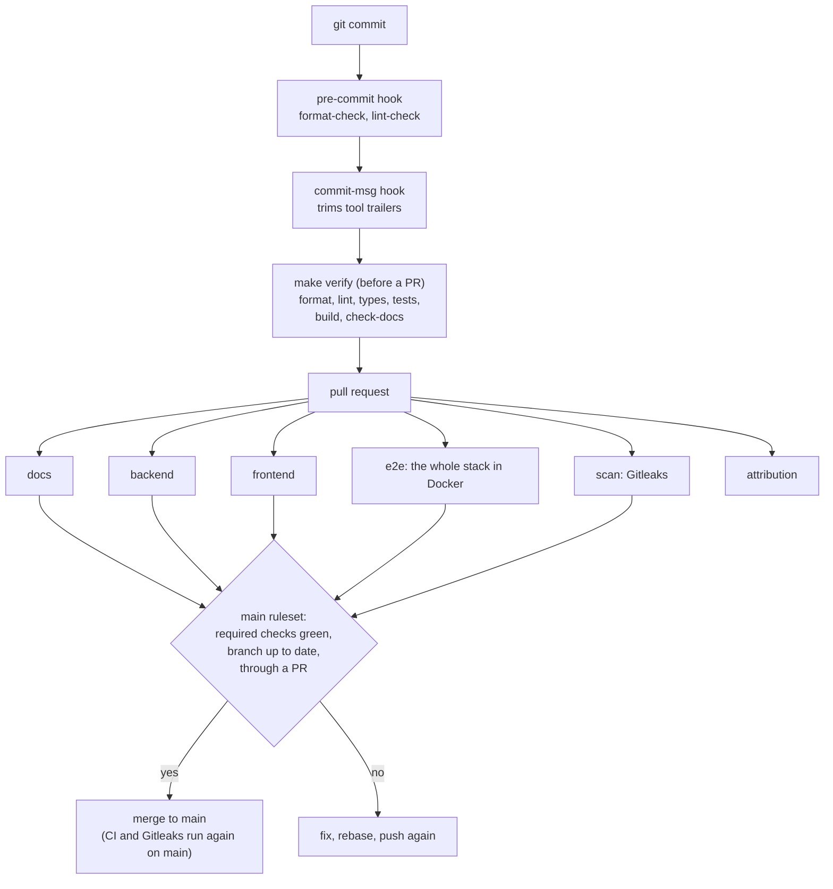

# CI and quality gates

What checks a change before it reaches `main`, what each check proves, and
how to show it at the defense. Companion to
[`security-checklist.md`](security-checklist.md) (the controls themselves)
and [`traceability.md`](traceability.md) (the subject's requirements).

The idea: nothing reaches `main` by hand. A commit is checked on the
machine, a pull request is checked by GitHub Actions on a fresh copy of the
whole stack, and `main` refuses a merge until every required check is green
on a branch that is up to date.

## The pipeline at a glance

## Stage by stage

| Stage | What runs | What it catches | Where |
|---|---|---|---|
| Pre-commit hook | `make format-check`, `make lint-check` (both packages) | unformatted code, a lint warning, a function over the complexity budget (ADR-0005) | `.githooks/pre-commit`, set by `make install` |
| Commit-msg hook | trims assistant / editor trailers from the message; never fails | tool attribution in the history | `.githooks/commit-msg` |
| `make verify` (local) | format, lint, typecheck, unit tests, build, `check-docs` | the same as CI's static jobs, before pushing | `Makefile` |
| CI `docs` | the doc checks' own tests, then `check-docs`: relative links, no long dashes, every env variable a doc cites exists, every route a doc cites has a controller **and** a Bruno request, every page reachable from `docs/README.md`, a warning above 300 lines | docs that drifted from the code | `scripts/check-docs.mjs`, `scripts/doc-checks/` |
| CI `backend` | `npm ci`, format, lint with `--max-warnings 0`, `tsc`, Jest, `nest build` | a type error, a failing unit test, a build break | `.github/workflows/ci.yml` |
| CI `frontend` | same chain with Vitest and `vite build` | same, for the SPA | `.github/workflows/ci.yml` |
| CI `e2e` | starts the dev stack with `docker compose up --build` on an empty database, then: | anything only the running app shows | `.github/workflows/ci.yml` |
| | the migrations build the schema, `migration:check` compares it with the entities | an entity changed without its migration (ADR-0010) | |
| | Playwright in Chromium and Firefox; a spec fails on any console error or warning it did not declare | a broken user flow, a console error (eliminatory at the defense) | `frontend/e2e/` |
| | the Bruno collection: every route with its exact status code (200, 201, 204, 302, 400, 401, 403, 404, 409, 422), refresh rotation and reuse detection, API keys | a wrong HTTP status, a REST regression, an ownership hole | `api/bruno/` |
| | builds the prod images and checks the prod SPA sends its Content-Security-Policy | a Dockerfile change that breaks only prod, a lost CSP (ADR-0014) | |
| CI `scan` | Gitleaks over the whole history of the branch | a secret committed, even in an old commit | `.github/workflows/gitleaks.yml` |
| CI `attribution` | refuses a PR whose commits or description name an AI assistant as author; tests its own detector first | tool attribution slipping past a machine without the hook | `.github/workflows/no-assistant-attribution.yml` |

On a failure, `e2e` uploads the Playwright and Bruno reports as artifacts of
the run (kept 7 days).

## What protects `main`

- **Required checks:** `backend`, `frontend`, `e2e`, `scan`, `docs`, and the
  branch must be up to date with `main` (a stale PR cannot merge: rebase,
  CI again, then merge).
- **Ruleset `protect_main`:** `main` cannot be deleted or force-pushed, and
  every change goes through a pull request. Copilot reviews each PR.
- **Merge commits only for the PR itself:** branches are rebased onto `main`,
  never merged with it (`CONTRIBUTING.md`).

## Dependencies

- **Dependabot version updates**, weekly, for `/backend`, `/frontend`, the
  root tooling and the GitHub Actions. Low-risk dev updates come grouped in
  one PR. Framework and compiler majors (Nest, TypeScript, `@types/node`,
  ESLint) are ignored there and done by hand, one branch each (HYP-41,
  `docs/deps/framework-major-upgrades.md`).
- **Dependabot alerts** are on (since 2026-11-02): GitHub flags a dependency
  with a known advisory. `npm audit --omit=dev` gives the same list locally.
- A transitive dependency pinned to a vulnerable version is forced to a
  patched one with npm `overrides`, each listed with its reason and its exit
  in [`deps/security-overrides.md`](../deps/security-overrides.md).
  `npm audit --omit=dev` is clean in both packages.

## Showing it at the defense

1. Open any merged PR, **Checks** tab: the six jobs and their logs.
2. Open the `e2e` job: the stack boot, `migration:check`, the Playwright list
   (Chromium and Firefox), the Bruno summary (every request passed).
3. Locally, `make verify`, then `make test-api` against the running stack:
   the same checks in a few minutes.
4. Break something on purpose, live: an `eslint-disable` or a 100-line
   function makes the pre-commit hook refuse the commit; a route cited in a
   doc without its Bruno request makes `make check-docs` fail.
5. Repository settings > Rules: the `protect_main` ruleset and the required
   checks.

Questions an evaluator may ask:

- *How do you know the API is RESTful and returns the right codes?* Bruno
  asserts the status of every request, in CI, on every PR; the 429s of the
  rate limits are asserted by `auth.throttle.spec.ts`.
- *What if someone forgets a migration?* `migration:check` in CI fails the
  PR.
- *How do you make sure there is no console error?* Every Playwright spec
  fails on a console error or warning it did not declare.
- *What stops a secret from landing in the repo?* `.env` is git-ignored,
  Gitleaks scans every PR and every push to `main`.

## Limits

- The OAuth providers are not reached in CI: their settings are
  placeholders, and the specs stop at the redirect (`frontend/e2e/oauth.spec.ts`).
  A real 42 / GitHub login is checked by hand.
- CI multiplies the rate limits by 100 (`THROTTLE_LIMIT_MULTIPLIER`): one
  runner plays every test from the same address. The limits themselves (the
  429s) are proved at their real values by a Jest HTTP spec
  (`backend/src/auth/auth.throttle.spec.ts`), and the env schema pins the
  multiplier to 1 in production.
- CI runs Docker only. The school machine's Podman is checked with
  `podman-compose config`, not by a CI job.
- Dependabot security updates (automatic fix PRs), GitHub secret scanning and
  push protection are off: Gitleaks covers secrets in commits.
