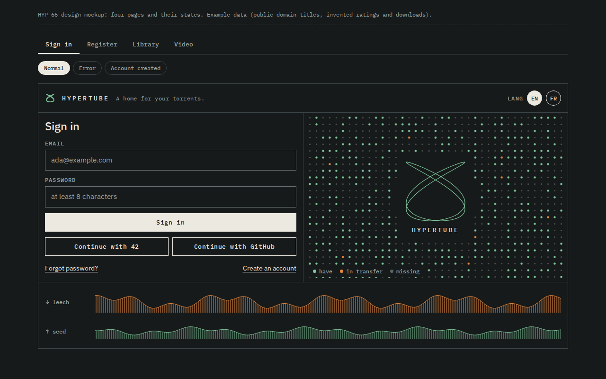
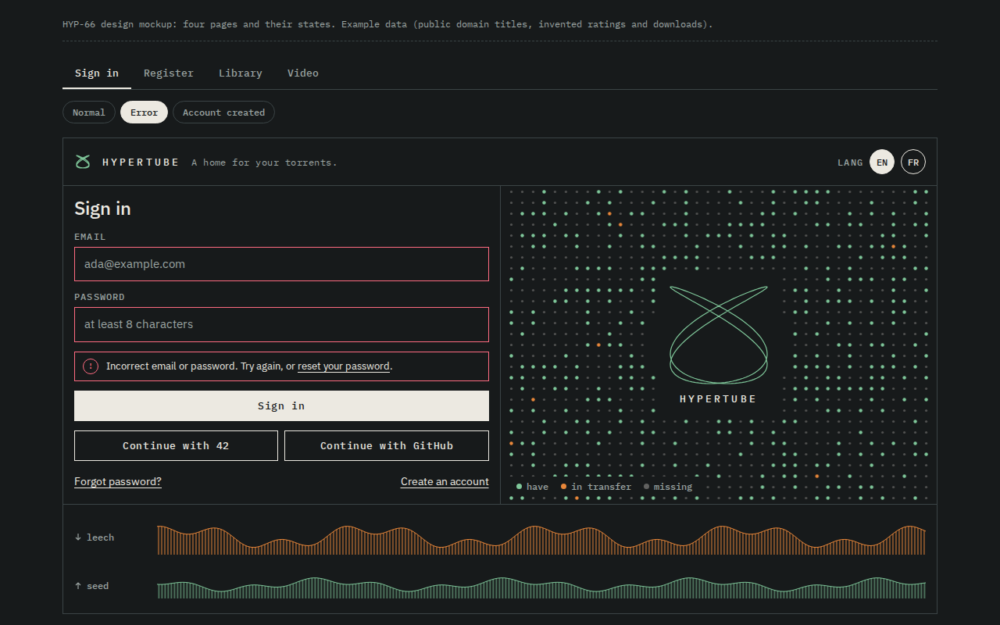
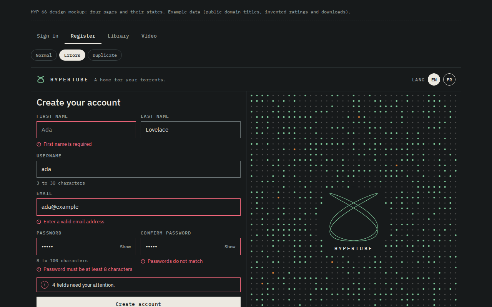
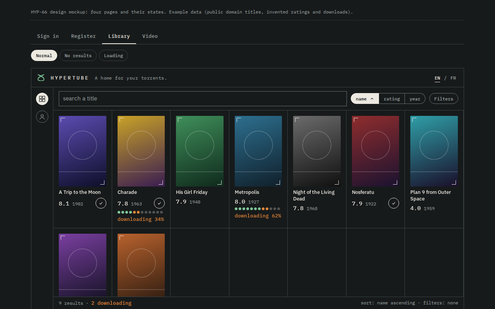
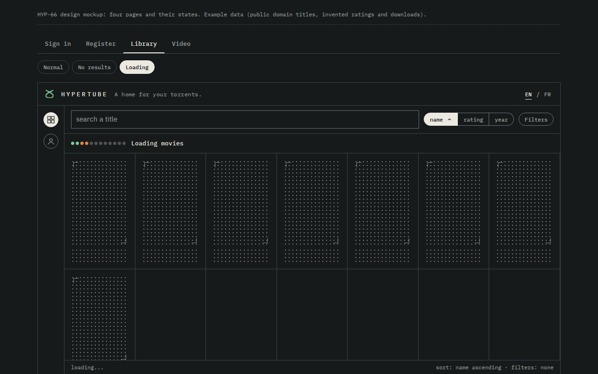
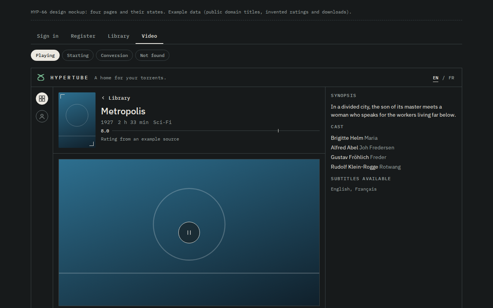
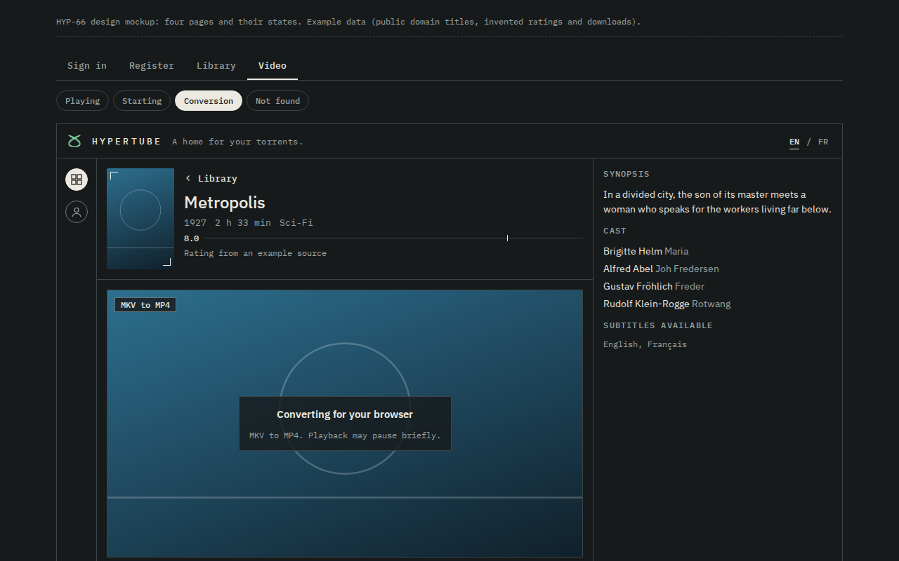

# Design

`hypertube-mockup.html` is the reference mockup for the visual identity
(HYP-66): sign in, register, library and video pages with their states
(error, empty, loading, starting, converting, not found). It is a static,
throwaway HTML file: open it in a browser, there is no build step. Titles,
ratings and download progress are example data.

It fixes the design tokens (colours, fonts, borders, focus), the accessibility
floor (WCAG AA text contrast, 3:1 functional borders, 24px minimum targets,
one `h1`, a `header` and a `main` per page) and the meaning of each colour:

- orange: a flow in progress only
- mint: the brand, "have" pieces, success and secondary accent
- alert red: errors only

The React app is the source of truth once the tokens land in
`frontend/src`; this file is not kept in sync with it.

## Screens

Captured from the mockup (1280 x 800). Regenerate them by opening the mockup
and choosing the page and state in its tabs.

| Sign in | Sign in, error |
| --- | --- |
|  |  |

| Register, errors | Library |
| --- | --- |
|  |  |

| Library, loading | Video |
| --- | --- |
|  |  |

