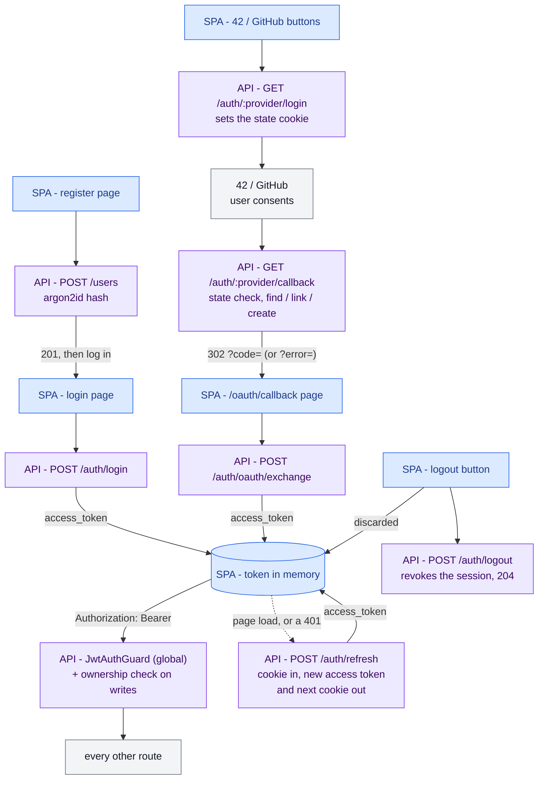
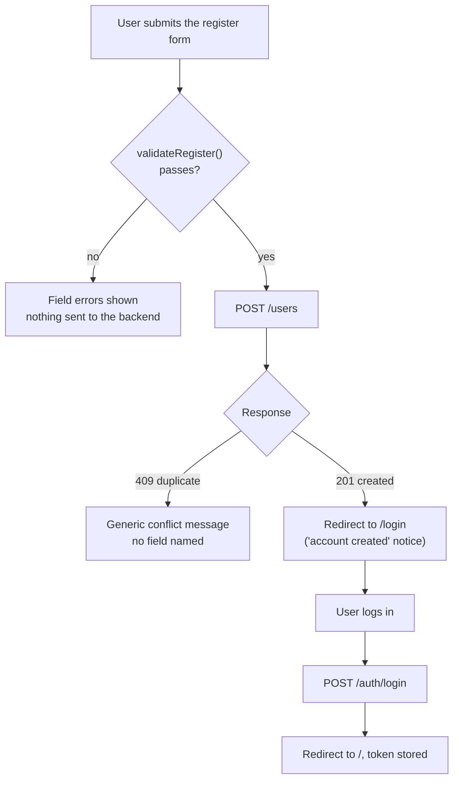
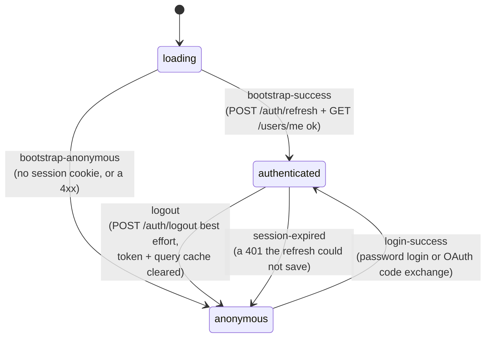
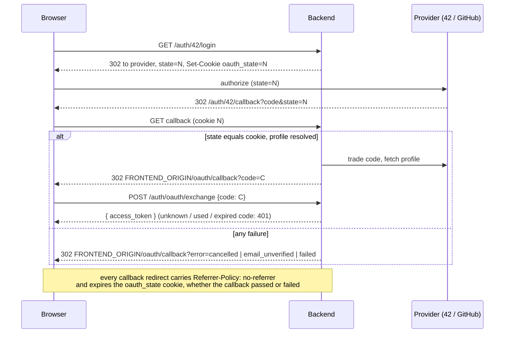
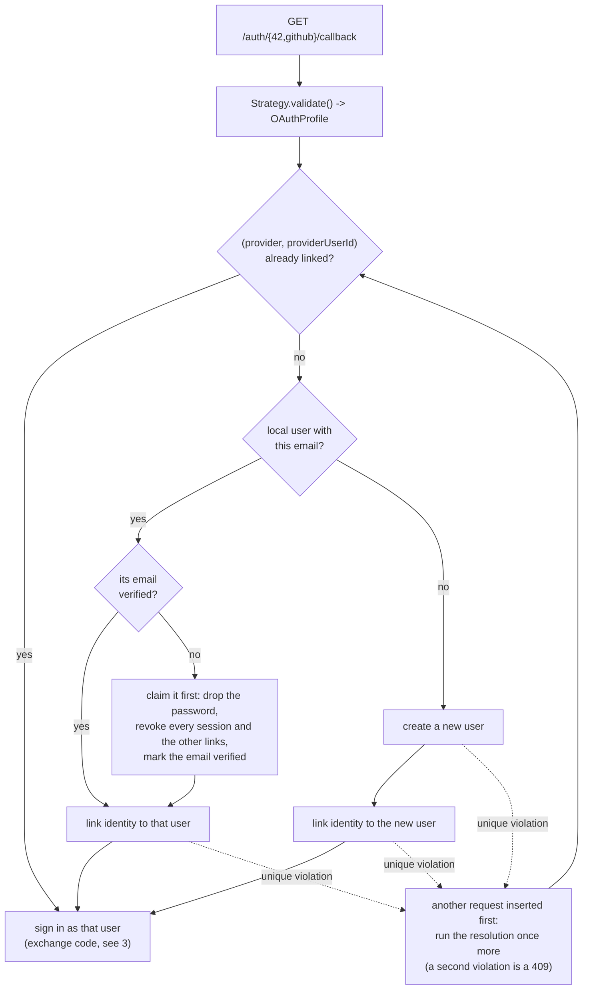
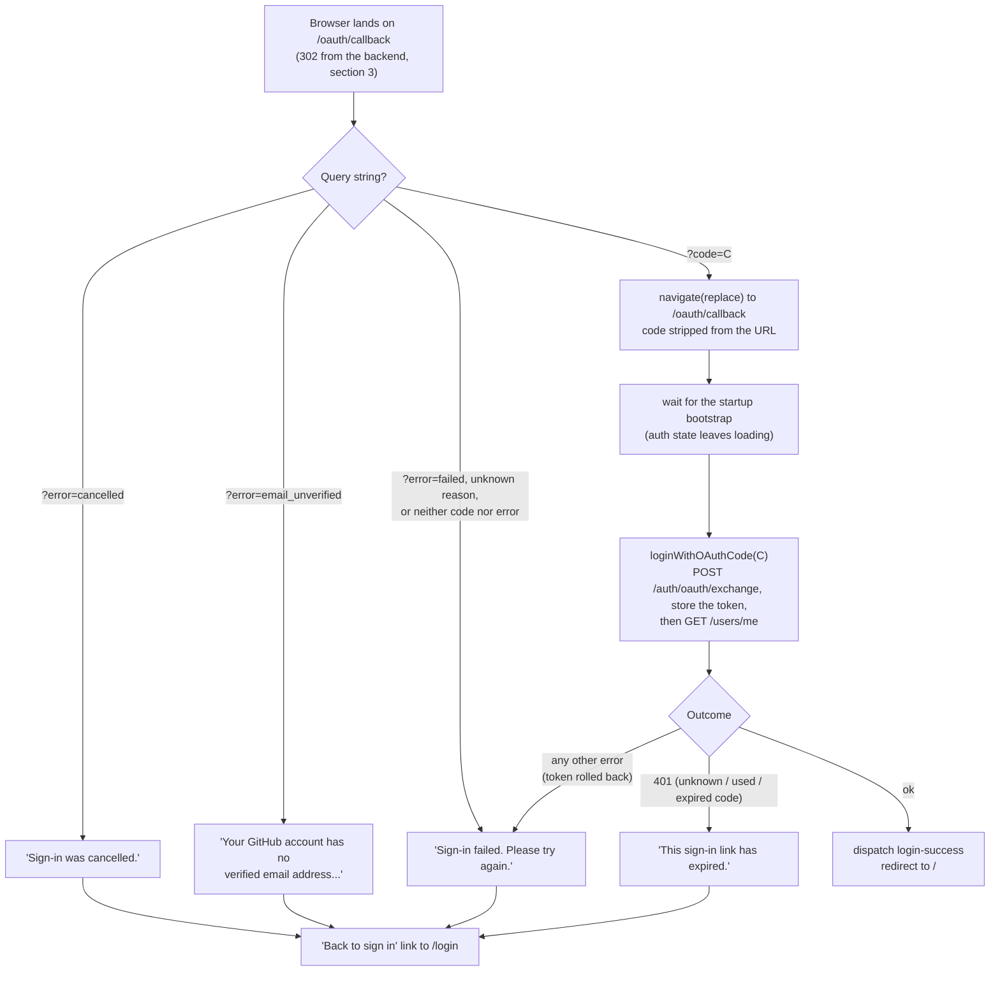
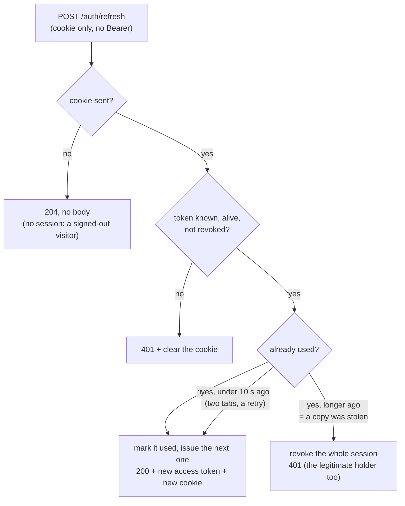
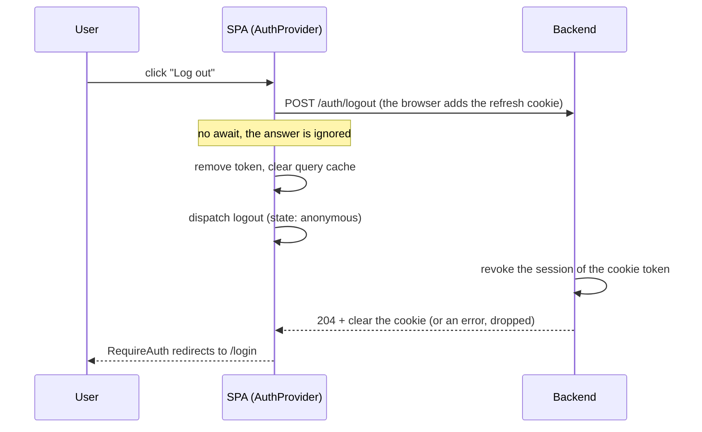
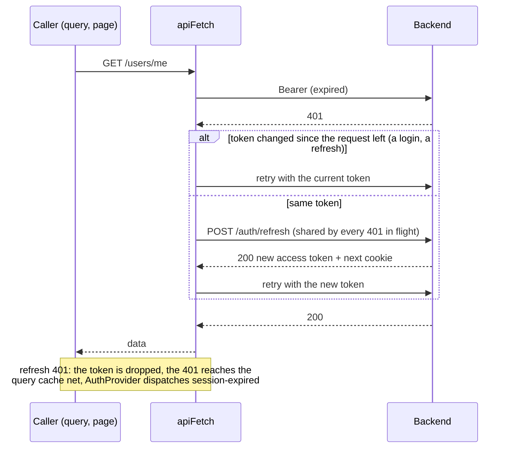
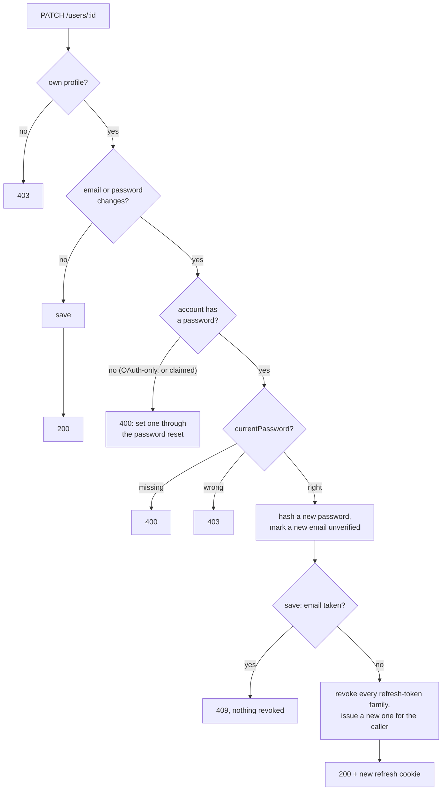

# Auth domain

How an account is created, how a browser gets a token (password or 42 /
GitHub), and how that token guards every other route. Start with the
overview, then open the detail that matches the code you are touching.

Decisions behind it: [ADR-0001](../adr/0001-hash-passwords-with-argon2id.md)
/ [ADR-0004](../adr/0004-pin-argon2id-cost-parameters.md) (argon2id),
[ADR-0002](../adr/0002-jwt-bearer-tokens-for-authentication.md) (JWT bearer),
[ADR-0006](../adr/0006-frontend-architecture.md) (frontend state),
[ADR-0007](../adr/0007-oauth-identity-linking-and-second-provider.md) (OAuth),
[ADR-0011](../adr/0011-rotating-refresh-tokens-in-an-httponly-cookie.md) (refresh tokens, logout).
The backend legs are also drawn as one poster in
[`auth-flow.png`](auth-flow.png), and the logout alone in
[`auth-logout.png`](auth-logout.png) (Excalidraw sources next to them).

## Overview

Blue: the SPA (`frontend/src/features/auth`). Violet: the backend
(`backend/src/auth`, `backend/src/users`). Grey: outside both.

What the overview hides, each covered below or in the ADRs: rate limits
(`security-checklist.md` section 7), the uniform 401 on login, the 403 on
another user's row, the SPA's session states and `RequireAuth` (section 2),
how the SPA keeps the session across a reload and a 401 (section 8), changing
the email or the password (section 9).

## 1. Register, frontend side (HYP-46)

The SPA never logs in on its own after a registration: a fresh account
always goes through the real login once.

## 2. Session states in the SPA (HYP-45)

`authReducer` (`auth-reducer.ts`): three states, five events. The events
that land on the same state stay distinct so a feature can react to the
cause (e.g. a "session expired" notice).

`RequireAuth` renders nothing while `loading`, its children when
`authenticated`, and redirects to `/login` when `anonymous`. The bootstrap
events only apply from `loading`: a startup check that settles after a login
is dropped.

## 3. OAuth handshake (HYP-11, HYP-53, HYP-57)

The JWT never appears in a URL: the callback hands the SPA a single-use
code, traded for the token by a `POST`.

## 4. OAuth identity linking (HYP-11)

`AuthService.resolveOAuthUser`: which local account a provider identity
signs into. The strategy has already refused a profile without a
provider-verified email (`UnverifiedEmailException`), so matching by email is
safe.

An account's email is verified when a provider vouched for it: created or
linked through OAuth. A local registration or an email change leaves it
unverified, and the next provider sign-in with that email claims the account
for its verified owner (ADR-0007, amendment 2026-10-25).

## 5. OAuth callback page, frontend side (HYP-57)

`auth-oauth-callback-page.tsx`: where section 3 hands the browser back to
the SPA. The code is removed from the URL before it is exchanged, and only
one exchange runs even under StrictMode's double effect. The exchange waits
for the startup bootstrap (section 8) to settle: a refresh that fails clears
the cookie, and landing after the exchange it would wipe the new session's. A success goes
through the same `login-success` event as a password login (section 2).

The page also sets `<meta name="referrer" content="no-referrer">`, and
the error messages are translation keys (`oauthCallback.errors.<code>`),
with the English and French texts in `auth-locale-en.ts` / `auth-locale-fr.ts`
(HYP-56).

## 6. Staying logged in: refresh and rotation (HYP-77)

Login and the OAuth exchange hand out two things: the access token in the body
(15 minutes) and a **refresh token in an `HttpOnly` cookie** (7 days, 30 at
most). When the access token expires, `POST /auth/refresh` trades the cookie for
a new access token **and the next cookie**: each refresh token works once.

Only the token's SHA-256 is stored, grouped by session (`familyId`). The SPA
side is section 8.

## 7. Logout (HYP-35, HYP-77)

`POST /auth/logout` is public and driven by the cookie, so it works with an
expired access token: it revokes the whole session, clears the cookie and
answers 204, even when there is nothing to revoke. The SPA calls it best effort
and signs out locally whatever the answer.

An access token copied before logout still works until it expires (15 minutes),
but nothing can renew it. Listed in
[`known-limitations.md`](../defense/known-limitations.md).

## 8. The SPA keeps the session (HYP-78)

The access token lives in a module variable (`lib/token.ts`), never in
`localStorage`, so a script cannot read it and a reload loses it. The refresh
cookie brings it back: on load, `restoreSession` (`auth-queries.ts`) calls
`POST /auth/refresh` then `GET /users/me`. Mid-session, `apiFetch` answers a
401 by refreshing once and retrying the request.

- **One refresh at a time.** Parallel 401s, and the two bootstrap runs of
  StrictMode in dev, share the refresh in flight: each rotation consumes the
  cookie, so a second one would present a used token.
- **A newer token wins.** A refresh that lands after a login or a logout does
  not overwrite what they set. The 401 net ends the session only when no token
  is left, so a 401 answered to a replaced token leaves the new session alone.
- **Login and logout wait for the refresh in flight.** A failed refresh clears
  the cookie; landing after a login it would wipe the new session's cookie,
  and a logout must revoke the cookie the refresh rotates in.
- **The auth routes are never retried**: their 401 is the answer (bad
  credentials, a dead cookie).

## 9. Changing the email or the password (HYP-84)

`PATCH /users/:id` takes the subject's username, email, password and profile
picture URL, on one's own profile only (403 otherwise). An email or password
change re-authenticates and ends every other session.

- The email is compared normalised: sending the current one back is no change.
- An account without a password cannot change either: an access token still
  alive after a claim (section 4) would otherwise set a password on the
  account its owner just took back. It sets one through the password reset,
  which proves it owns the email (HYP-34).
- A wrong `currentPassword` is a 403, not a 401: the request is refused, the
  session stays, and the SPA does not refresh for nothing.
- The route is throttled (10 per minute), since it checks a password.
- The caller's own cookie never reaches `/users` (it is scoped to the auth
  routes), hence "revoke all, then issue one" rather than "all but this one".
