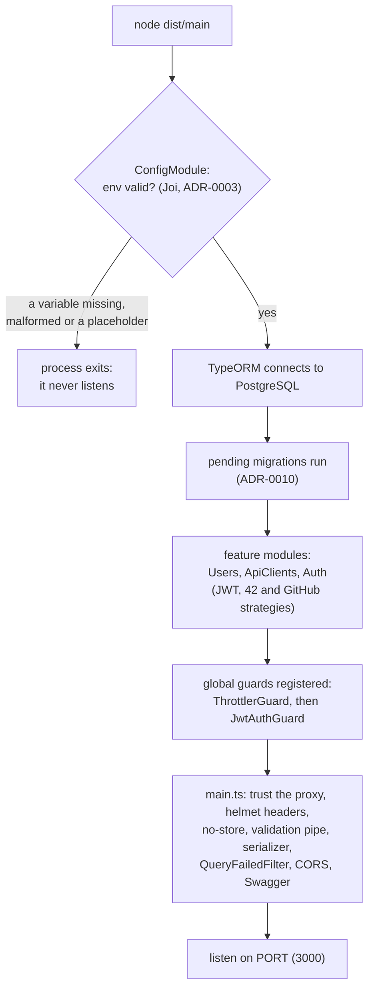
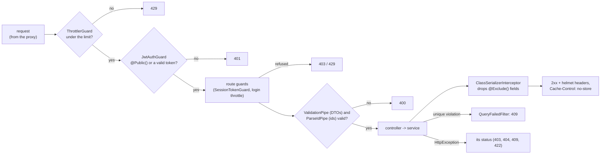

# Backend domain

How the NestJS app starts, and what every request goes through inside it once
the edge proxy hands it over ([`network.md`](network.md) covers the proxy).
Code: `backend/src/app.module.ts` (the composition root) and
`backend/src/main.ts` (the bootstrap).

## Overview: the boot order

- **A bad environment never starts.** The schema is checked before anything
  connects; a missing secret or a value left from `.env.example` stops the
  boot with the variable's name.
- **The schema is current before the first request.** Migrations run as part
  of the database connection, so a request never meets an old schema.
- **Everything that applies to every route is set once**, in `main.ts` or as
  a global guard in `app.module.ts`, never per controller.
- `enableShutdownHooks()`: on `docker stop` (SIGTERM) the app closes its
  database connections instead of dropping them.

## 1. One request inside Nest

- **Order matters:** a flood is cut by the rate limit before it costs a token
  check, and an anonymous request is refused before any validation or
  database work.
- **Deny by default:** `JwtAuthGuard` protects every route; `@Public()` opens
  one explicitly.
- **The DTO is the contract:** the global pipe drops an undeclared field and
  answers 400 if one is sent (`whitelist`, `forbidNonWhitelisted`), so a
  client cannot slip in `isAdmin` or an `id`.
- **`no-store` on every answer**, so the browser never replays per-user data;
  `GET /pictures/:name` overrides it with a year-long `immutable` (a name's
  bytes never change).
- **Nothing sensitive leaves:** the serializer strips `password`,
  `secretHash` and `credentialsChangedAt` even when a query loaded them, and
  the filter answers a unique violation with a 409 that names no value.
