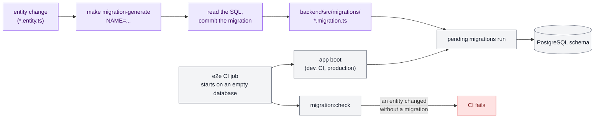
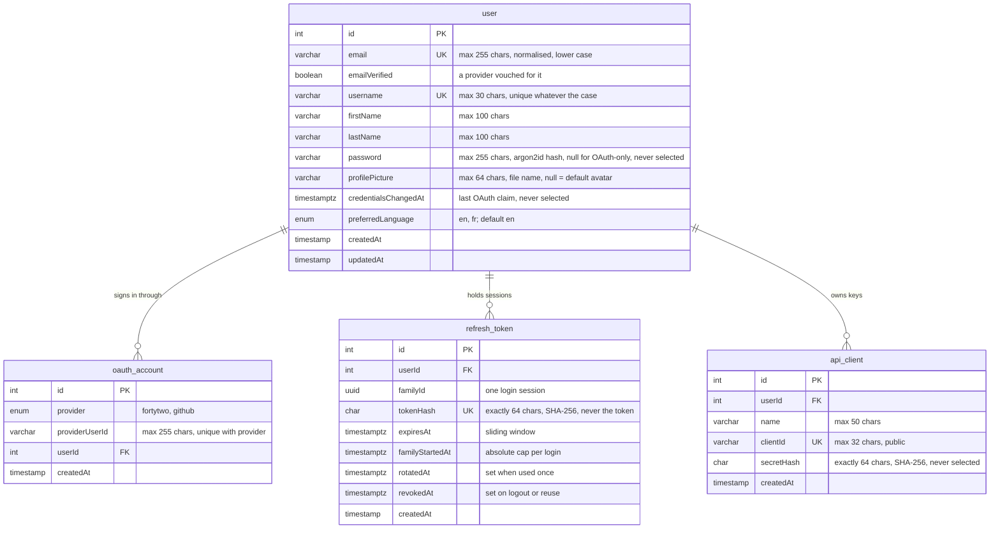

# Database domain

How the schema is built and kept in step with the entities (decision:
[ADR-0010](../adr/0010-typeorm-migrations-build-the-schema.md)), and the
tables it holds.

## Overview

## Tables (ERD)

The schema today: accounts and what hangs off them. The movie, torrent and
comment tables come with the core (HYP-12 / 13 / 14). Read from the database
the migrations build (`make psql`, then `\d "user"`), not only the entities.

- **Deleting a user deletes the rest:** every foreign key is
  `ON DELETE CASCADE` (sessions, provider links, API keys), and the service
  deletes the picture file.
- **Indexes:** each `userId` is indexed, and so is `refresh_token.familyId`
  (a reused token revokes its whole family in one query). The username is
  unique twice: as typed, and through `UQ_user_username_lower` on
  `LOWER(username)`, an expression index that lives in its migration only.
- **What is never stored in clear:** the password (argon2id, ADR-0001), the
  refresh token and the API key secret (SHA-256: they are random, a slow
  hash adds nothing, ADR-0011 and ADR-0015).
- **Never read by default:** `password`, `secretHash` and
  `credentialsChangedAt` are `select: false` and excluded from responses.
- `migrations` is TypeORM's own bookkeeping table (which migrations ran),
  not part of the model.
