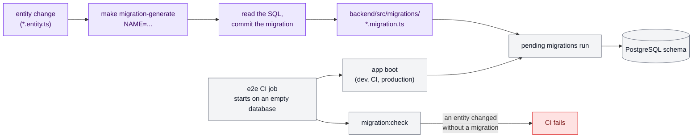
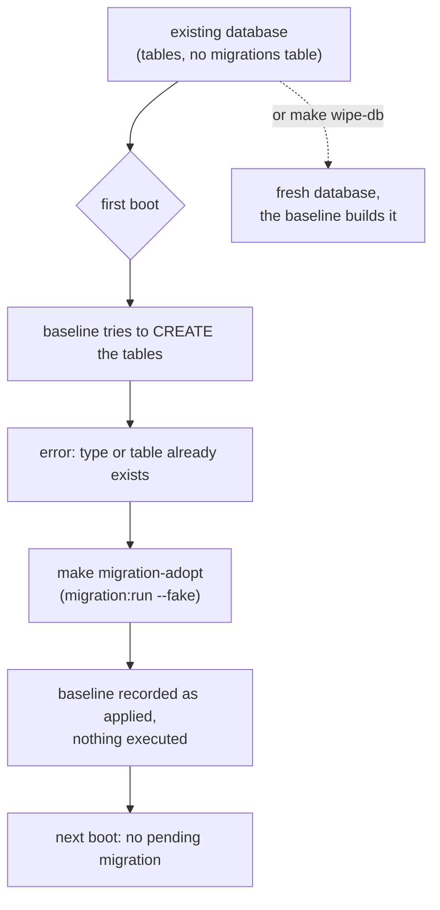

# Database domain

How the schema is built and kept in step with the entities. Decision:
[ADR-0010](../adr/0010-typeorm-migrations-build-the-schema.md). The ERD of the
tables is still to come (defense packet, HYP-59).

## Overview

## 1. A database that predates the migrations

A database created before the migrations existed (by `synchronize`) has the baseline's tables,
so running the baseline fails with "already exists". It is adopted once:

A fresh database needs nothing: the baseline runs at the first boot.
