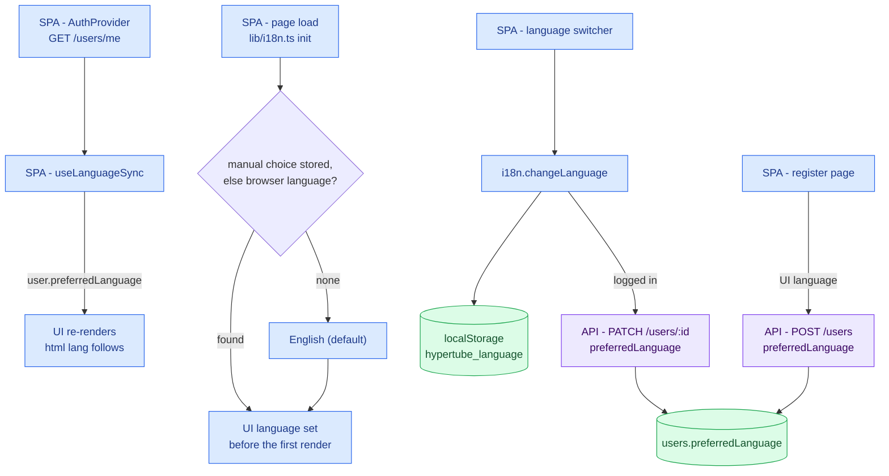
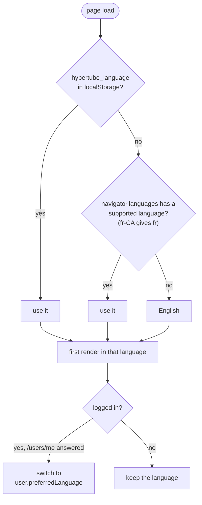
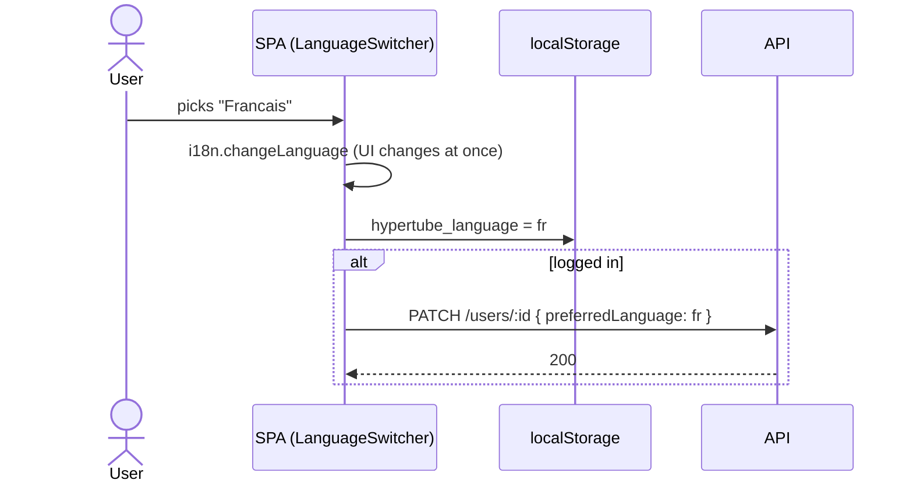
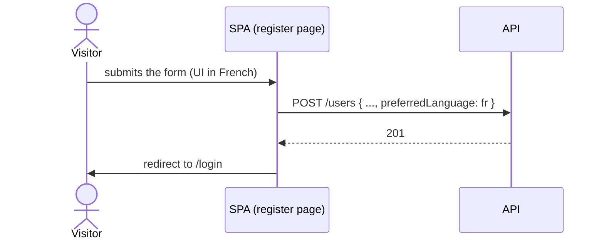

# Language domain (i18n)

Which language the UI speaks, how that choice is remembered, and how it
follows a user from one browser to another. Start with the overview, then
open the detail that matches the code you are touching.

English is the default and the fallback (subject requirement). The same
flows are also drawn as one poster in
[`i18n-language.png`](i18n-language.png) (Excalidraw source next to it).

Decision: react-i18next, recorded in HYP-56. No ADR: nothing here is a
structural choice beyond the library.

## Overview

## 1. Which language wins (HYP-56)

Two moments, two sets of information. At page load nothing is known about
the account, so the language comes from what the browser holds. Once
`GET /users/me` answers, the account language takes over. Logging out
puts the first rule back.

Priority at login: account language, then manual choice, then browser,
then English. The starting language is resolved in `lib/i18n.ts` before
the first render, so there is no flash of English; the account language
arrives later, in `useLanguageSync`.

## 2. Switching language (HYP-56)

A failed `PATCH` keeps the new language on screen and shows nothing: the
account stays on its old language until the next successful switch. The
auth user held in memory is not refreshed after a `PATCH`.

## 3. Registration (HYP-56)

The register page sends the language the visitor is browsing in. Without
it a new account is saved as `en`, and the account language wins at login,
so a French visitor would be flipped back to English on their first login.

