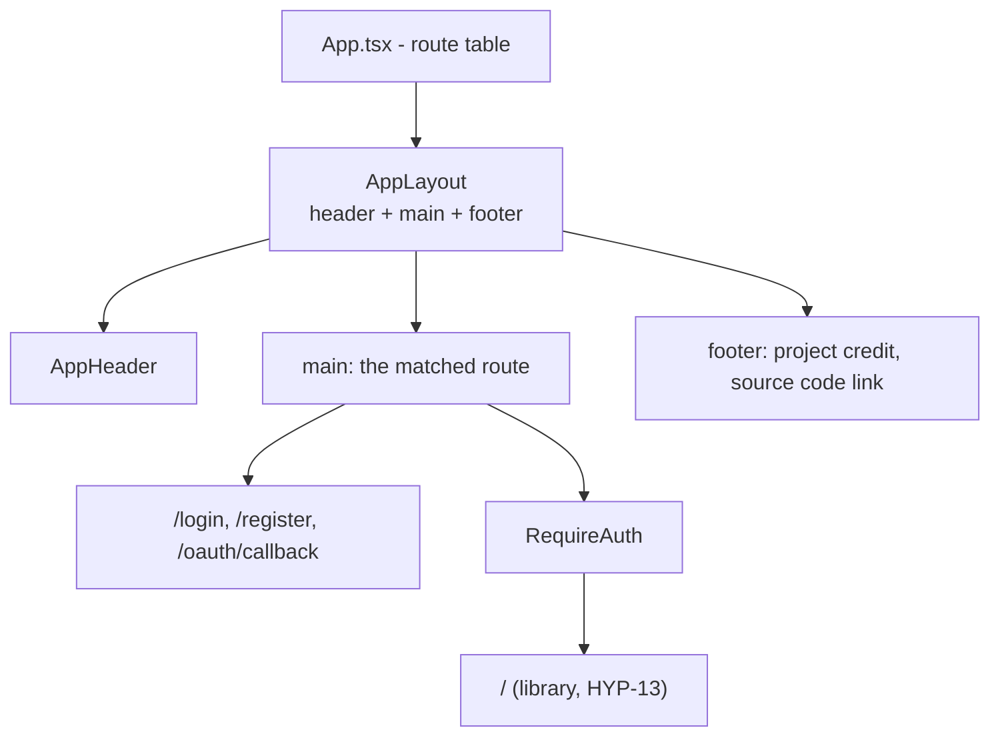
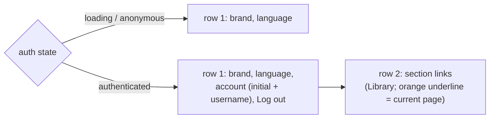

# Layout

The frame around every page of the SPA: what the header, main and footer
hold, and how they change with the session.

## Overview

`AppLayout` is a layout route wrapping the whole route table: every page
renders inside its one `<main>`, between the header and the footer. Pages
render only their own content.

## 1. Header by session state (HYP-19)

The header reads the session from `AuthContext`. Signed out (or while the
session is still loading) it holds the brand and the language picker; signed
in it adds the account, the one-click logout and a row of section links, so
each is one click away from any page.

On a phone (below 640 px) the language label and the username are for
screen readers only, and the controls wrap under the brand when a long label
in another language would not fit. `frontend/e2e/layout.spec.ts` checks
both pages at 320 px wide, with no sideways scroll, in Chromium and Firefox.
