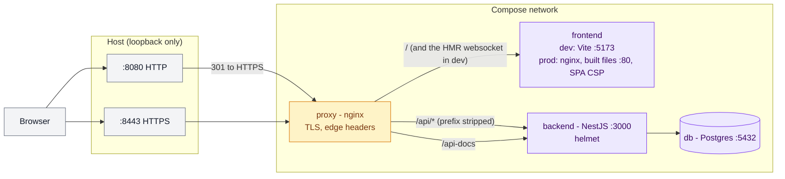
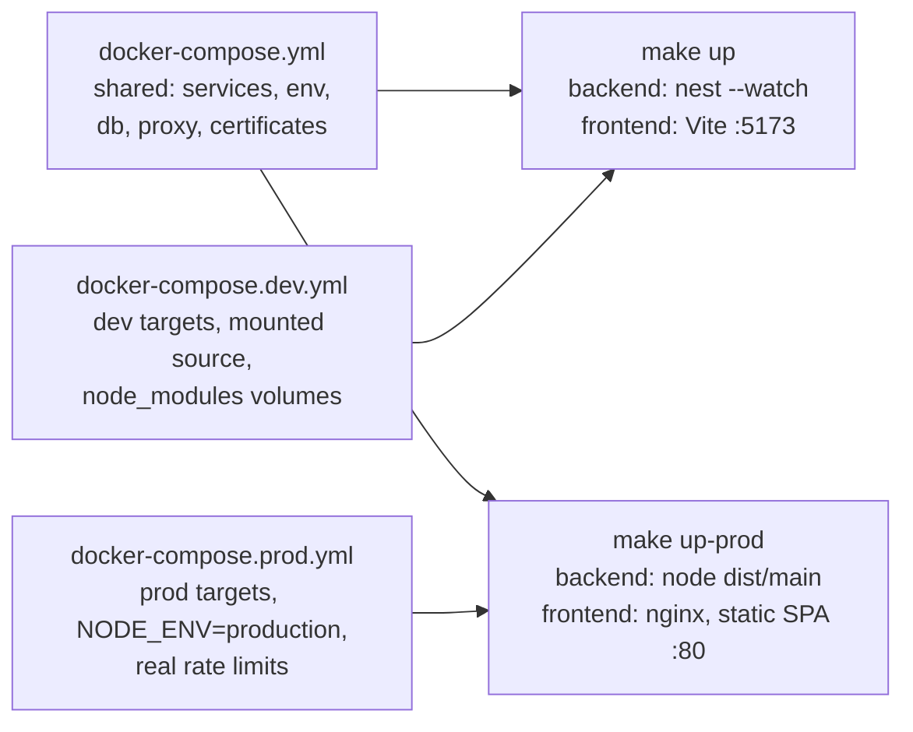
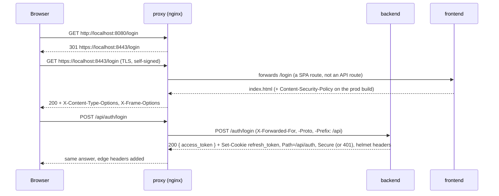
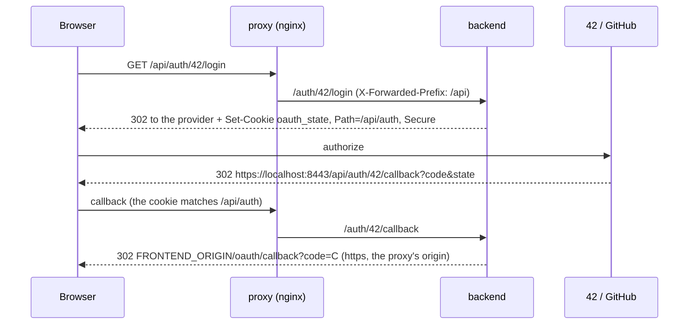
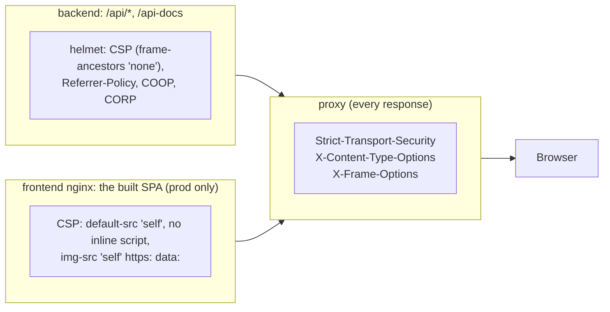

# Network domain

How a browser request reaches the app: one entry point that terminates TLS
and routes to the services on the compose network. Decision:
[ADR-0009](../adr/0009-nginx-edge-proxy-with-tls.md) (HYP-71).

## Overview

Amber: the edge. Violet: the services. Grey: the browser and the host ports.
The proxy is the only way in: the backend and the frontend publish no host
port. Bruno and the e2e suite go through it too.

## Dev and prod stacks (HYP-17)

The same services in two builds, chosen by which compose files are stacked
([ADR-0013](../adr/0013-compose-base-with-dev-and-prod-files.md)).

The proxy picks the SPA's address from `PROXY_FRONTEND_UPSTREAM`. Both stacks
are one compose project: `make up-prod` replaces the dev containers, `make up`
switches back, and the database volume stays.

## 1. One request through the edge

## 2. OAuth through the edge

The backend trusts one proxy hop (`trust proxy`), so the rate limiter keys on
the client address nginx appended and `req.secure` follows
`X-Forwarded-Proto`.

## 3. Who sets which security header (HYP-49)

One owner per header, so none reaches the browser twice
([ADR-0014](../adr/0014-security-headers-split-between-edge-backend-and-spa.md)).

The dev SPA (Vite) has no CSP: its inline react-refresh script and injected
`<style>` tags would need `unsafe-inline`.
