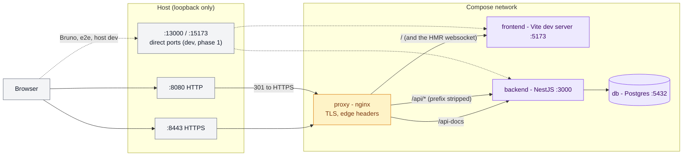
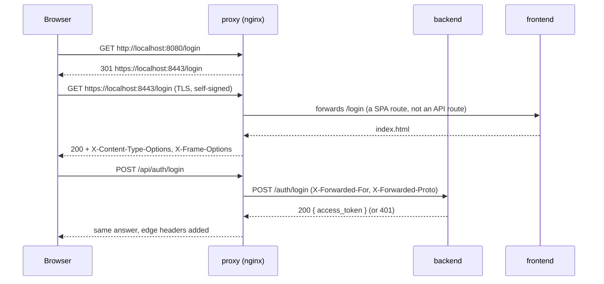

# Network domain

How a browser request reaches the app: one entry point that terminates TLS
and routes to the services on the compose network. Decision:
[ADR-0009](../adr/0009-nginx-edge-proxy-with-tls.md) (phase 1 of HYP-71).

## Overview

Amber: the edge. Violet: the services. Grey: the browser and the host ports.
Dashed: the direct ports of phase 1, which phase 2 removes so that the proxy
is the only way in.

## 1. One request through the edge

## Not yet (phase 2)

Direct ports unpublished, `trust proxy` in the backend (so the rate limiter
sees the real client), Bruno and the CI e2e job behind the proxy, OAuth over
HTTPS (callback URLs and the state cookie path).
