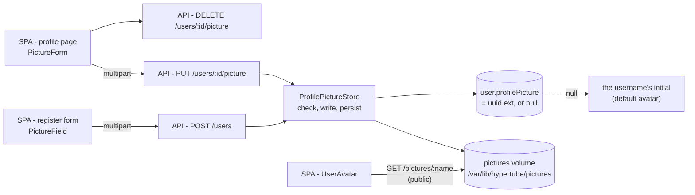
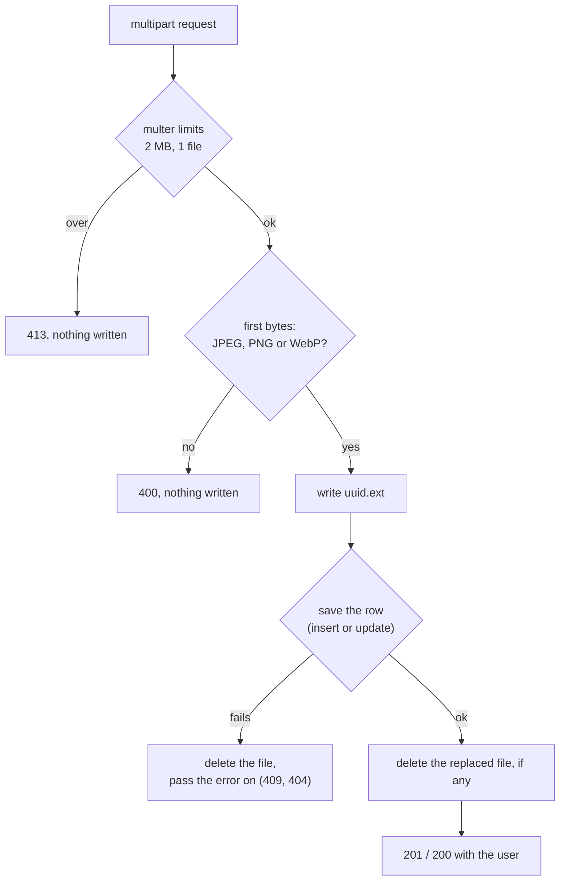
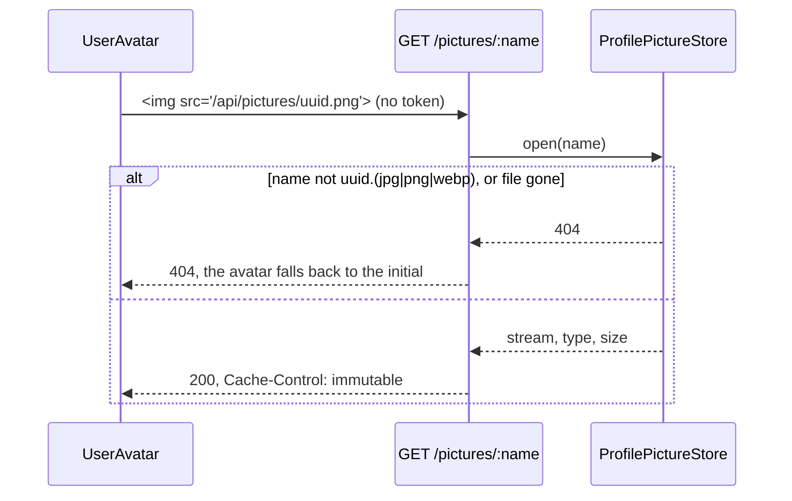

# Profile pictures domain

How a picture gets from the register form or the profile page to the disk,
and back to every `` that shows it. Decision:
[ADR-0016](../adr/0016-profile-pictures-uploaded-and-stored-on-a-volume.md).

## Overview

## 1. Storing an upload (HYP-38)

The same path for a registration with a picture and for a replacement.

- The client checks the type and size first (`validatePicture`), so a wrong
  pick shows its error before any request; the backend has the final say.
- A refused pick on the register form stops the submit: registering without
  it would silently drop what the user chose.

## 2. Showing a picture (HYP-38)

- Public because an `` cannot send the bearer token; the random name is
  what keeps a picture from being found by user id.
- Cached for good: a new upload gets a new name, never new bytes behind an
  old one.
